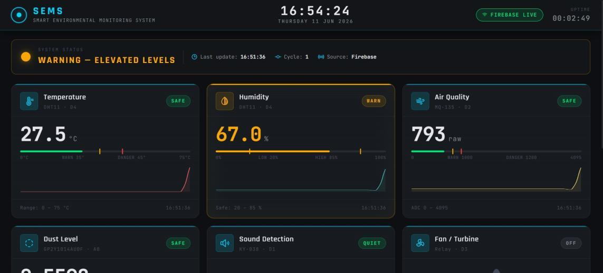

# Smart Environmental Monitoring System (SEMS)

**Personal portfolio presentation of a collaborative IoT environmental-monitoring capstone, built at Bahçeşehir University, Capstone II, June 2026.**

**Repository owner and maintainer:** Hummam Wala Mohammad Yassin, Computer Engineering. This is a team capstone presented here as a personal portfolio project; Hummam did not independently develop the complete system.

SEMS brings temperature, humidity, relative air quality, dust and ambient sound readings into a browser dashboard. A Seeed Studio XIAO ESP32-C6 samples the sensors, evaluates local ventilation thresholds and sends the latest reading over Wi-Fi to Firebase Realtime Database. The dashboard presents sensor cards, status indicators, alerts and short trend charts.

The project addresses a practical problem: classrooms, laboratories and other indoor spaces often lack an affordable way to observe changing conditions remotely. It combines embedded programming, cloud data handling and frontend development in one student-built prototype.

> **Recovery status:** This repository preserves the original 11-commit project history and this portfolio repository's existing history. Firmware was recovered from uncommitted files in the supplied ZIP; the live-capable frontend was recovered from the team's deployed Netlify site on 18 November 2026. Private settings are excluded. Hardware-to-cloud operation has not been revalidated during recovery. See [provenance and changes](docs/recovery.md).

## System architecture


**Sensors → XIAO ESP32-C6 → Wi-Fi → Firebase `/sensors/latest` → web dashboard.**

The relay decision runs locally on the microcontroller. Firebase is a monitoring channel; the dashboard does not send fan-control commands. Local sensing can continue after Wi-Fi connection failure, although startup waits up to approximately 15 seconds for Wi-Fi and synchronous HTTP requests can delay sampling.

## Hardware

| Component | Purpose | Recovered final connection |
|---|---|---|
| Seeed Studio XIAO ESP32-C6 | Sensor acquisition, local decisions and Wi-Fi | Main board |
| DHT11 | Temperature and relative humidity | D4 / GPIO22 |
| MQ-135 | Relative air-quality indication, raw ADC | D2 / GPIO2 |
| GP2Y1014AU0F | Uncalibrated optical dust estimate | A0 / GPIO0; LED control D5 / GPIO23 |
| KY-038 | Ambient sound indication, raw analog value | D1 / GPIO1 |
| Relay and fan | Prototype ventilation actuation | D3 / GPIO21 |

This mapping agrees with Table 2 of the final report and the private configuration paired with the recovered firmware. Earlier commits contain different assignments and a single-pin dust implementation; use the current example, not those historical wiring comments. Confirm board labels, signal voltages, power and grounding before wiring.

## Software and cloud stack

- C/C++, Arduino IDE, Espressif ESP32 board support, WiFi/HTTPClient and Adafruit DHT libraries.
- Firebase Realtime Database: firmware REST uploads and browser real-time subscription.
- HTML, CSS and JavaScript; Chart.js 4.4.0; Firebase compat SDK 10.12.2.
- Netlify static hosting and Git/GitHub version control.

The recovered versions are recorded for reproducibility; this is not a claim that dependencies are current or production-hardened.

## Data flow and implemented features

| Capability | What the recovered code does |
|---|---|
| Sensor sampling | Reads four sensors; DHT validity and MQ warmup are included in the payload |
| Latest upload | HTTP `PUT` to `/sensors/latest.json`, nominally every 5 seconds |
| Live dashboard | Subscribes to `sensors/latest` and maps the firmware's current field names |
| Status and alerts | Per-sensor thresholds, overall status, alert banner and event log |
| Fan display | Displays the uploaded software state; it does not confirm physical movement |
| Trend charts | Four rolling buffers of 20 readings in browser memory, initially seeded with defaults |
| Fallback demo | Simulated readings when configuration is absent or initialization/read fails; explicitly labelled **FALLBACK DATA** |
| Persistent history | `/sensors/history` is an intended extension; no upload or history query is implemented |

The firmware's `timestamp` is `millis()` (uptime in milliseconds), not Unix time. The dashboard shows local receipt time. See the [payload example](firebase/latest.example.json) and [technical audit](docs/technical-audit.md).

## Dashboard screenshots

The dashboard code supports a simulated fallback when Firebase is not configured. Browser screenshot capture was unavailable in this recovery environment.



Historical evidence: Figure 3 from the final report shows the team's Firebase Live deployment. It is not evidence that a device is currently transmitting.

## Repository structure

```text
firmware/main/               ESP32-C6 sketch and safe configuration example
web-dashboard/frontend/     Recovered HTML, CSS and JavaScript
web-dashboard/firebase/     Browser configuration example
firebase/                   Example payload and deny-by-default rules
docs/capstone-reports/       Authoritative university report
docs/images/                Report figures and recovery screenshot
docs/                       Recovery, security, technical and validation notes
tests/                      Recovery-time automated checks
netlify.toml                Static hosting configuration
```

## Run and configure

### Dashboard demonstration

From the repository root, run:

```sh
python -m http.server 8000 --directory web-dashboard
```

Open `http://localhost:8000/frontend/`. Without local Firebase settings, the dashboard uses labelled simulated fallback data. External CDNs supply Chart.js, Firebase, icons and fonts; internet access is needed for those assets. A missing `firebase-config.js` request is expected until you configure it.

### Firebase configuration

1. Create or select your own Firebase Realtime Database project.
2. Copy `web-dashboard/firebase/firebase-config-example.js` to `firebase-config.js` in the same directory and enter your browser app settings. This local file is ignored by Git. Browser app identifiers are visible to site visitors; never put privileged keys there.
3. Review [security and access limitations](docs/security.md) before connecting a device. `firebase/database.rules.example.json` denies all access intentionally. It is a safe baseline, **not** a working access policy for the recovered clients.
4. Implement an authenticated device write path and an appropriate dashboard read policy before cloud deployment. The recovered firmware makes unauthenticated REST requests and the frontend has no sign-in flow. Do not enable unrestricted writes to make the prototype work.

### Firmware

1. Install Arduino IDE, Espressif ESP32 board support including `XIAO_ESP32C6`, **DHT sensor library** by Adafruit and its **Adafruit Unified Sensor** dependency. Original toolchain versions were not recorded.
2. Copy `firmware/main/config.example.h` to `firmware/main/config.h`. Supply your Wi-Fi settings and database URL, without a trailing slash. Keep this file private.
3. Check wiring against the table above and review the prototype thresholds. The dashboard and firmware have different recovered temperature and dust thresholds; reconcile them before relying on consistent alerts.
4. Open `firmware/main/main.ino`, select the board and serial port, compile and upload. Use the Serial Monitor at 115200 baud.
5. Validate sensors locally, then verify authenticated cloud access and actual HTTP success. The original serial message says “Data sent” for any positive HTTP status, including rejected requests.

### Static hosting

The supplied Netlify configuration publishes `web-dashboard/` and redirects `/` to `/frontend/`. Supply your local browser configuration through your deployment process. No Netlify deployment or Firebase rules change was performed during repository recovery.

## Testing and validation

Run the dependency-free logic tests and static audit from the repository root:

```sh
node --check web-dashboard/frontend/script.js
node --test tests/dashboard.test.cjs
python tests/static_checks.py
```

See [validation results](docs/validation.md) for checks actually executed, unverified browser, hardware and cloud behavior. The report records T-01–T-04 as Pass and T-05 relay/fan actuation as Partial. Those are the team's original results, not recovery-time test results. The ZIP's test-results file was empty.

## Known limitations

- MQ-135 and GP2Y readings are uncalibrated relative indicators. Dust conversion is approximate and is not a certified PM2.5 measurement; KY-038 values are not decibels.
- Physical relay/fan actuation was only partially validated in the capstone due to wiring and 3.3 V logic compatibility.
- Cloud monitoring requires network connectivity. The firmware has no explicit reconnection/backoff or offline queue; HTTP calls can block the sensor loop.
- The recovered firmware and deployed dashboard use different temperature/dust alert thresholds. The firmware's dust danger threshold is above the maximum produced by its nominal ADC conversion.
- The dashboard has no stale-reading timeout, robust payload validation, user authentication or persistent history. A “Firebase Live” label alone does not establish fresh hardware data.
- Some original event-log behavior can repeat fan entries; sensor validity metadata is stored but does not suppress stale DHT values in the cards.

This is an academic prototype, not an industrial-grade, production-ready or certified safety instrument. Details and exact differences are in the [technical audit](docs/technical-audit.md).

## Future improvements

Calibrate sensors against reference instruments; validate the relay driver and power stage; reconcile thresholds and units; introduce authenticated writes, payload validation and stale-data handling; implement server timestamps, durable history, reconnection and offline buffering; then test long-duration operation, enclosure design and usability.

## Portfolio contribution and team

This was a collaborative university capstone developed by Computer Engineering and Electrical and Electronics Engineering students at **Bahçeşehir University, Faculty of Engineering and Natural Sciences**, for **Capstone II, 2026**. This repository is maintained by Hummam Wala Mohammad Yassin as a personal portfolio presentation of his documented work within that team project.

The final report's original names and contribution record remain unchanged in the [academic report](docs/capstone-reports/SEMS-Capstone-II-Final-Report.pdf). For this portfolio README, other students are anonymized as requested. Their departments and contribution boundaries follow Section 7.2, Table 7 of that report.

| Team member | Department | Principal contributions |
|---|---|---|
| **Hummam Wala Mohammad Yassin — Computer Engineering** | Computer Engineering | Web dashboard development (HTML/CSS/JavaScript), Firebase real-time data binding, Chart.js visualizations, dashboard status and alert logic, QR-code access |
| **Member 1** | Computer Engineering | Firmware data handling and Firebase upload logic, Firebase schema, repository setup/version control, pin-mapping coordination and Netlify deployment |
| **Member 2** | Electrical and Electronics Engineering | Sensor selection/sourcing, sensor-array breadboard wiring, power-distribution layout and bench verification of analog readings |
| **Member 3** | Electrical and Electronics Engineering | GP2Y driver circuit, relay wiring/fan actuation stage, sensor handling and calibration preparation |
| **Member 4** | Electrical and Electronics Engineering | KY-038 integration/threshold setup, relay supply/safety review, breadboard layout, labelling and assembly support |

Hummam also presented the cloud/Firebase integration section during the final defense. This presentation role is separate from the implementation responsibilities credited above.

Advisors: **Assist. Prof. Ece Gelal** (Computer Engineering) and **Prof. Dr. Şeref Kalem** (Electrical and Electronics Engineering).

Original team source repository: [NoorZannad/smart-environment-monitoring-system](https://github.com/NoorZannad/smart-environment-monitoring-system). The report's poster identifies [semsp.netlify.app](https://semsp.netlify.app/) as the deployed dashboard; source assets were accessible during recovery. No new code license has been inferred or assigned to the team's work.
