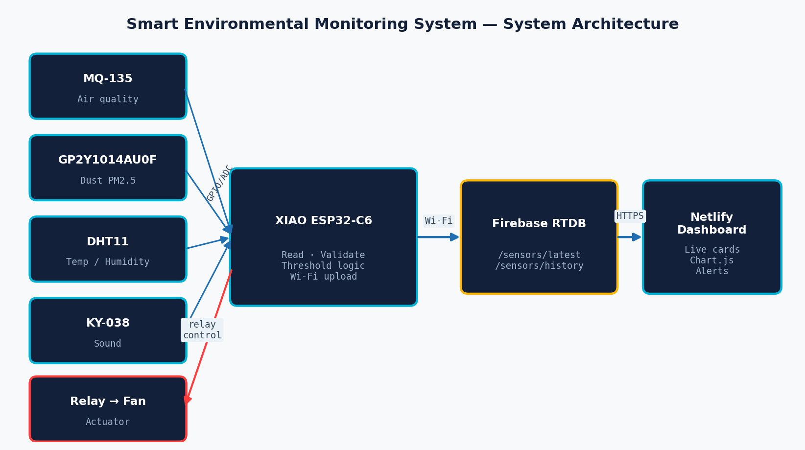

# Smart Environmental Monitoring System (SEMS)

**Hummam Wala Mohammad Yassin** — Computer Engineering Graduate, Bahçeşehir University  (Repository maintainer)

SEMS is an IoT prototype that monitors temperature, humidity, relative air quality, dust and ambient sound. A Seeed Studio XIAO ESP32-C6 reads the sensors, evaluates local ventilation thresholds and sends the latest reading over Wi-Fi to Firebase Realtime Database. A browser dashboard displays sensor values, status indicators, alerts and short trend charts.

> Developed as a collaborative Computer Engineering and Electrical/Electronics Engineering capstone project at Bahçeşehir University. This portfolio describes my engineering contributions within the team project; I did not develop the entire system independently.

## Project overview

Classrooms, laboratories and other indoor spaces can benefit from accessible environmental monitoring. SEMS combines embedded firmware, cloud data flow and a web dashboard in a low-cost academic prototype. Its readings are intended to indicate relative changes, not to serve as certified measurements or safety alarms.

## System architecture



**Sensors → XIAO ESP32-C6 → Wi-Fi → Firebase `/sensors/latest` → web dashboard**

Threshold and relay logic runs on the microcontroller. The cloud and dashboard provide monitoring; the dashboard does not control the fan. The device can continue local sampling when Wi-Fi is disconnected after startup, though blocking network requests can delay its loop.

## Technologies and hardware

**Software:** C/C++ with Arduino IDE, ESP32-C6 board support, WiFi/HTTPClient, Adafruit DHT library, Firebase Realtime Database, HTML, CSS, JavaScript, Chart.js, Netlify, Git and GitHub.

**Hardware:**

- Seeed Studio XIAO ESP32-C6 microcontroller
- DHT11 temperature and humidity sensor
- MQ-135 relative air-quality sensor
- GP2Y1014AU0F optical dust sensor
- KY-038 analog sound-level indication module
- Relay module and fan for prototype ventilation actuation

The recovered final pin map is in the firmware configuration example and the academic report. MQ-135 and GP2Y readings are uncalibrated relative indicators; KY-038 values are raw readings, not decibels.

## Key features

- Samples four sensors and applies local threshold logic.
- Sends the current reading to Firebase at `/sensors/latest` using HTTP PUT.
- Subscribes to the latest reading in the browser and updates sensor cards, status, alerts and fan state.
- Shows short Chart.js trends using 20 in-memory readings per chart; initial chart points are defaults.
- Uses clearly labelled simulated fallback data when Firebase configuration or connection is unavailable.

Persistent `/sensors/history` uploads and historical chart queries are not implemented. Payload fields and timing details are described in the [technical audit](docs/technical-audit.md).

## My Contributions

I worked directly on ESP32-C6 firmware as well as the web dashboard. My contributions included:

- Editing and debugging firmware, uploading it to the physical microcontroller and testing its behavior.
- Diagnosing sensor integration and hardware/software communication problems.
- Troubleshooting ESP32 Wi-Fi connectivity and Firebase Realtime Database integration.
- Debugging the sensor-to-cloud-to-dashboard pipeline and helping teammates resolve integration issues across hardware, firmware, Wi-Fi and Firebase.
- Developing the HTML, CSS and JavaScript dashboard, including live Firebase data binding, Chart.js visualizations, status and alert indicators, and QR-code access.

These are my hands-on engineering contributions within a collaborative project; the system also includes work by the rest of the capstone team.

## Technical Challenges & Solutions

- **Sensor and firmware integration:** Sensor readings had to be brought together with ESP32-C6 firmware and pin assignments. I edited and deployed firmware to the physical board, tested behavior, debugged integration issues and helped teammates trace problems between sensor hardware and software. The final pin map is documented in the report and configuration example.
- **Wi-Fi and cloud data flow:** Connectivity problems can interrupt the path from the device to Firebase. I troubleshot Wi-Fi and Firebase integration and helped follow readings through the sensor-to-cloud-to-dashboard pipeline. The recovered firmware writes only the latest record; it has no offline queue or explicit reconnection/backoff, and authenticated cloud access remains future work.
- **Live dashboard synchronization:** The browser must map Firebase fields to the displayed readings and indicate whether it is live or using fallback data. The recovered dashboard subscribes to `/sensors/latest`, with a simulated fallback when the connection fails. It has no stale-reading timeout, and its temperature and dust thresholds differ from firmware thresholds.
- **Relay and fan compatibility:** The capstone report records inconsistent physical relay/fan actuation due to wiring sensitivity and the ESP32-C6's 3.3 V logic compatibility. The firmware generates relay state in software, but physical actuation was only partially validated. A suitable driver or level-shifting stage was identified as future improvement; this README does not claim the hardware issue was fully resolved.

My role included hands-on debugging and helping the team resolve technical problems. This does not mean every issue was resolved: cloud access, data freshness, calibration and physical actuation retain the limitations described above and in the [technical audit](docs/technical-audit.md).

## Dashboard screenshots


This image is historical evidence from the report. It does not confirm that a device is currently transmitting. Browser screenshot capture was unavailable during recovery.

## Installation and configuration

### Run the dashboard fallback

From the repository root:

```sh
python -m http.server 8000 --directory web-dashboard
```

Open `http://localhost:8000/frontend/`. Without local Firebase settings, simulated readings are shown and labelled as fallback data. The dashboard loads Chart.js, Firebase, icons and fonts from external CDNs, so those assets need internet access.

### Configure Firebase

1. Create a Firebase Realtime Database project.
2. Copy `web-dashboard/firebase/firebase-config-example.js` to `web-dashboard/firebase/firebase-config.js` and enter your browser app settings. The local file is ignored by Git. Browser app identifiers are public; do not put privileged credentials in frontend files.
3. Review [security guidance](docs/security.md). The included rules example denies all access and is not a working policy for the recovered clients.
4. Implement an authenticated device write path and an appropriate dashboard read policy before deployment. The recovered firmware sends unauthenticated REST requests, and the dashboard has no sign-in flow.

### Build and upload firmware

1. Install Arduino IDE, Espressif ESP32 support including `XIAO_ESP32C6`, Adafruit DHT sensor library and its Adafruit Unified Sensor dependency.
2. Copy `firmware/main/config.example.h` to `firmware/main/config.h`; enter your Wi-Fi settings and database URL locally. Do not commit this file.
3. Check the pin map, wiring, voltage levels and prototype thresholds before connecting hardware.
4. Open `firmware/main/main.ino`, choose the board and serial port, then compile and upload. The serial monitor uses 115200 baud.
5. Verify sensor behavior and actual HTTP response codes. The original firmware logs “Data sent” for any positive HTTP status, including rejected requests.

## Testing and validation

Run the available local checks:

```sh
node --check web-dashboard/frontend/script.js
node --test tests/dashboard.test.cjs
python tests/static_checks.py
```

The five automated dashboard tests simulate Firebase behavior; they are not live-service tests. See [validation results](docs/validation.md). The final report records T-01 through T-04 as passed and T-05 relay/fan actuation as partial. Those are the team's reported tests, not recovery-time hardware results. Hardware, firmware compilation, Wi-Fi and live Firebase behavior were not revalidated during repository recovery.

## Known limitations

- MQ-135 and GP2Y readings are uncalibrated relative indicators; the dust conversion is approximate. The system is not a certified measurement or safety device.
- Physical relay/fan actuation was only partially validated because of wiring and 3.3 V logic compatibility.
- Cloud monitoring depends on Wi-Fi. There is no offline queue or explicit reconnection/backoff, and blocking HTTP calls can delay sampling.
- Firmware and dashboard use different temperature and dust thresholds. The firmware's configured dust danger threshold is above its nominal conversion range.
- Dashboard data has no stale-reading timeout or strict payload validation. DHT failure metadata does not prevent stale values from appearing.
- Persistent history, authentication, multi-user access and long-term field operation are not implemented.

SEMS is an academic prototype, not an industrial-grade or production-ready system.

## Future improvements

Calibrate the gas and dust sensors against reference instruments; reconcile threshold values and units; validate a level-shifted relay driver; add authenticated cloud access, payload validation and stale-data handling; implement persistent timestamped history and offline buffering; and test long-duration operation in a protective enclosure.

## Project Maintainer

**Hummam Wala Mohammad Yassin** — Computer Engineering Graduate, Bahçeşehir University. Repository maintainer and contributor to firmware debugging and deployment, Wi-Fi/Firebase integration, end-to-end troubleshooting and dashboard development.

## Academic acknowledgment

Collaborative Capstone II project at Bahçeşehir University, developed across Computer Engineering and Electrical and Electronics Engineering. The original final report, including its full team credits, is preserved unchanged in [`docs/capstone-reports/`](docs/capstone-reports/).
